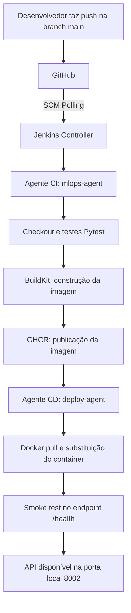

# Jenkins MLOps Lab — CI/CD de uma API com FastAPI e Docker

Laboratório prático de **MLOps e integração/entrega contínua (CI/CD)** usando **Jenkins**, **Python/FastAPI**, **Pytest**, **Docker**, **BuildKit** e **GitHub Container Registry (GHCR)**.

O objetivo é demonstrar como uma alteração enviada ao GitHub pode iniciar um processo automatizado de testes, construção de imagem, publicação e implantação de uma aplicação, com uma verificação final de funcionamento.

> **Status do laboratório:** pipeline executado com sucesso no Jenkins (build **#6**), com **5 testes aprovados**, imagem `ghcr.io/lucassldantas/jenkins-mlops-api:6` publicada e API implantada localmente na porta `8002`. O endpoint `/health` retornou HTTP 200.

## 1. O que a aplicação faz

A aplicação é uma **API demonstrativa de análise de sentimento**, desenvolvida com FastAPI. Ela permite exercitar endpoints de classificação de textos positivos, negativos e neutros, além de disponibilizar um endpoint de saúde (`/health`) para validar se o serviço está respondendo.

**Importante:** o foco deste repositório é o **processo de CI/CD e a operação da aplicação**, não o treinamento ou o monitoramento de um modelo de machine learning em produção. A classificação de sentimento é utilizada como exemplo didático; não deve ser confundida com um modelo de ML treinado e versionado neste laboratório.

## 2. Tecnologias utilizadas

| Tecnologia | Papel no projeto |
| --- | --- |
| **GitHub** | Hospedagem e versionamento do código-fonte |
| **Jenkins** | Orquestração do pipeline CI/CD |
| **Python + FastAPI** | Implementação da API |
| **Pytest** | Execução de testes automatizados |
| **Docker** | Empacotamento e execução da aplicação em container |
| **BuildKit** | Construção da imagem Docker no pipeline |
| **GHCR** | Registro de imagens Docker versionadas |
| **Docker Compose** | Inicialização dos componentes locais do Jenkins |
| **WSL2 + Docker Desktop** | Ambiente utilizado na execução do laboratório |

## 3. Arquitetura



O laboratório utiliza **dois agentes Jenkins com funções separadas**:

- **`mlops-agent` (CI):** executa o checkout, prepara o ambiente Python, roda os testes e constrói/publica a imagem por meio do BuildKit.
- **`deploy-agent` (CD):** acessa o Docker Engine local, baixa a imagem publicada, atualiza o container da aplicação e executa o smoke test.

O Jenkins Controller coordena as etapas. A detecção de alterações no GitHub foi configurada por **SCM Polling** (consulta periódica), e não por webhook.

## 4. Etapas do pipeline

O arquivo [`Jenkinsfile`](Jenkinsfile) define o fluxo:

1. **Checkout:** obtém o código da branch configurada no Jenkins.
2. **Preparar ambiente Python:** cria um ambiente virtual e instala as dependências.
3. **Testes automatizados:** executa os testes com Pytest. Se falharem, o pipeline é interrompido.
4. **Docker Build:** constrói a imagem com BuildKit.
5. **Publicar no GHCR:** envia a imagem para `ghcr.io/lucassldantas/jenkins-mlops-api:<BUILD_NUMBER>`.
6. **CD — Deploy:** o agente de deploy baixa a imagem e substitui o container `jenkins-mlops-deploy`.
7. **CD — Smoke Test:** verifica a resposta do endpoint `/health` dentro do container, com tentativas de espera durante a inicialização.

A imagem recebe como tag o **número da execução do Jenkins**, permitindo identificar qual build foi implantado.

### Resultado observado

Na execução **#6**:

- Os **5 testes** foram aprovados.
- A imagem `ghcr.io/lucassldantas/jenkins-mlops-api:6` foi publicada no GHCR.
- O container foi atualizado para a versão `:6`.
- O smoke test passou.
- A requisição `curl -i http://localhost:8002/health` retornou **HTTP 200** e `{"status":"ok"}`.

## 5. Estrutura principal do projeto

```text
jenkins-mlops-lab/
├── app/                         # Código da API FastAPI
├── tests/                       # Testes automatizados
├── jenkins/                      # Infraestrutura Jenkins e agentes
│   ├── compose.yaml             # Serviços do laboratório
│   ├── Dockerfile.agent         # Imagem do agente de CI
│   ├── Dockerfile.deploy-agent  # Imagem do agente de deploy
│   └── start-agent.sh           # Inicialização dos agentes
├── Dockerfile                   # Imagem da aplicação
├── Jenkinsfile                  # Pipeline CI/CD
├── requirements.txt             # Dependências Python
└── README.md
```

Os arquivos de segredos utilizados pelos agentes e as credenciais do GHCR **não devem ser versionados**. Os tokens devem permanecer protegidos no Jenkins e nos arquivos locais ignorados pelo Git.

## 6. Como verificar a aplicação

Com o laboratório configurado e o pipeline executado, a API fica disponível **na própria máquina que hospeda o Docker Desktop**:

```bash
curl -i http://localhost:8002/health
```

Resposta esperada:

```http
HTTP/1.1 200 OK
content-type: application/json

{"status":"ok"}
```

Para identificar a versão em execução:

```bash
docker inspect jenkins-mlops-deploy --format '{{.Config.Image}}'
```

> A porta `8002` está publicada em `127.0.0.1`, portanto a aplicação **não está exposta publicamente na internet**. Para reproduzir o pipeline em outra máquina, é necessário configurar previamente Jenkins, agentes, BuildKit, credenciais do GHCR e acesso ao Docker Engine. Este repositório não oferece implantação pública pronta para uso.

## 7. Jenkins: vantagens e desvantagens

### Vantagens

- **Flexibilidade:** pipelines e agentes podem ser personalizados conforme a infraestrutura e as necessidades do projeto.
- **Controle da execução:** permite administrar diretamente servidores, agentes, ferramentas, credenciais e políticas de execução.
- **Ecossistema de plugins:** integra-se a diversos serviços, ferramentas de testes e ambientes de implantação.
- **Independência da plataforma Git:** pode ser utilizado com diferentes provedores de repositórios e ambientes corporativos.
- **Adequação a ambientes internos:** útil quando o deploy precisa acessar recursos privados, redes internas ou infraestrutura própria.

### Desvantagens

- **Maior esforço operacional:** instalação, atualizações, backups, monitoramento e manutenção ficam sob responsabilidade da equipe.
- **Configuração mais complexa:** exige conhecimento de agentes, permissões, plugins, rede e infraestrutura.
- **Responsabilidade pela segurança:** é necessário proteger credenciais, controlar acesso e manter os componentes atualizados.
- **Custo de infraestrutura:** o Jenkins é open source, mas os servidores e o trabalho de administração não são gratuitos.
- **Risco de dependência de plugins:** atualizações ou incompatibilidades podem exigir manutenção adicional.

## 8. Jenkins vs. GitHub Actions

**A principal diferença está em onde e como a automação é operada:**

- **Jenkins:** é um servidor de automação que a equipe instala e administra, com controle direto sobre controller, agentes e infraestrutura.
- **GitHub Actions:** é um serviço de automação integrado ao GitHub; os workflows são definidos no repositório e podem executar em runners hospedados pelo GitHub ou em runners próprios.

| Critério | Jenkins | GitHub Actions |
| --- | --- | --- |
| **Configuração inicial** | Geralmente mais trabalhosa | Geralmente mais simples em repositórios GitHub |
| **Onde se define o pipeline** | Normalmente em um `Jenkinsfile` (Groovy) | Em arquivos YAML em `.github/workflows/` |
| **Execução** | Agentes gerenciados pela equipe | Runners do GitHub ou self-hosted |
| **Manutenção da plataforma** | Responsabilidade da equipe | Plataforma gerenciada pelo GitHub; runners próprios continuam exigindo manutenção |
| **Integração com GitHub** | Via plugins e configuração de SCM/webhooks | Nativa |
| **Personalização de infraestrutura** | Muito ampla | Ampla, sobretudo com runners próprios, mas sujeita ao modelo do Actions |
| **Custos** | Infraestrutura e operação próprias | Dependem de plano, uso, tipo de runner e infraestrutura própria |
| **Ambientes internos** | Natural com agentes na rede corporativa | Possível com runners self-hosted e controles adequados |
| **Curva de aprendizado** | Geralmente maior | Geralmente menor para equipes que já usam GitHub |

### Qual escolher?

**GitHub Actions tende a ser uma boa escolha** quando o código já está no GitHub, a equipe quer começar rapidamente e não deseja administrar um servidor de automação.

**Jenkins tende a ser uma boa escolha** quando há necessidade de grande personalização, integração com infraestrutura existente, múltiplas origens de código ou controle direto dos agentes e do ambiente de execução.

Nenhuma das duas ferramentas é universalmente superior. **Ambas conseguem executar testes, construir imagens, publicar no GHCR e realizar deploy**. A escolha depende principalmente de requisitos operacionais, governança, segurança, custos e experiência da equipe.

## 9. Relação com MLOps

Este laboratório demonstra a **base de automação e entrega contínua** que pode ser utilizada em projetos de machine learning:

- versionamento de código;
- execução automática de testes;
- empacotamento reproduzível em containers;
- publicação de artefatos versionados;
- implantação automatizada;
- validação básica do serviço após o deploy.

Em um projeto de **MLOps completo**, também seriam necessários processos adicionais, como versionamento de datasets e modelos, rastreamento de experimentos, avaliação de métricas do modelo, monitoramento de desempenho e *data drift*, além de estratégias de retreinamento. **Esses recursos não estão implementados neste laboratório.**

## 10. Limitações e melhorias futuras

O projeto é uma demonstração local e não deve ser tratado como uma arquitetura pronta para produção.

- **Rollback automático:** atualmente não existe recuperação automática da imagem anterior se o smoke test falhar.
- **Disponibilidade:** a substituição do container provoca uma breve interrupção do serviço.
- **Segurança do Docker socket:** o `deploy-agent` tem acesso ao Docker Engine, o que concede privilégios elevados; esse modelo requer isolamento e controle de acesso rigorosos em ambientes reais.
- **Credenciais:** melhorar o isolamento do `DOCKER_CONFIG` temporário durante o deploy.
- **Eficiência:** evitar checkouts adicionais nos estágios que não precisam do código-fonte.
- **Testes:** ampliar a validação pós-deploy para além do endpoint `/health`.
- **Observabilidade:** adicionar logs centralizados, métricas e alertas.
- **Gatilho de execução:** avaliar webhooks do GitHub em vez de SCM Polling.

## 11. Conclusão

O laboratório demonstra um ciclo funcional de **CI/CD com Jenkins**, desde o `git push` até a execução da nova versão de uma API em Docker. A separação entre agentes de CI e CD ajuda a compreender as responsabilidades de construção, publicação e implantação.

A principal aprendizagem é que **Jenkins e GitHub Actions resolvem problemas semelhantes de automação**, mas diferem na experiência de configuração, no controle da infraestrutura e no esforço de manutenção.

---

**Projeto acadêmico demonstrativo de MLOps e CI/CD.**
